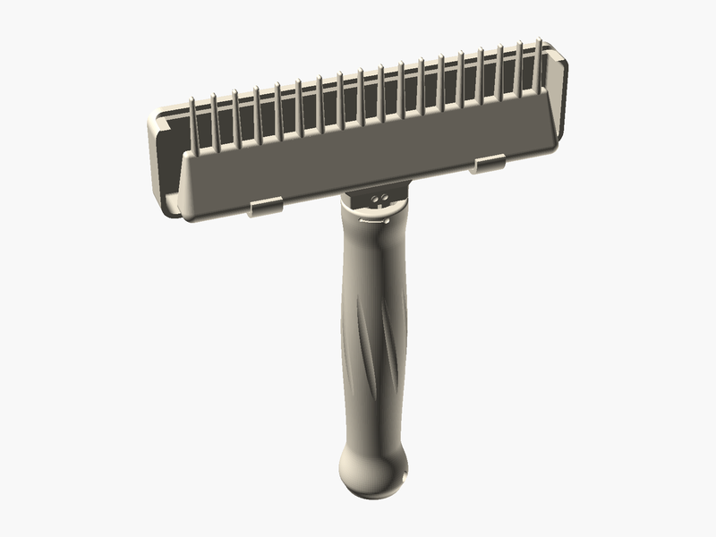

# Native Seed Comb

**Created by:** Luke

This is a comb for harvesting seeds and berries from native plants. You pull the comb through a plant's seed heads and the teeth gently pop the seeds and berries off. A cup clips onto the back of the comb to catch them as they fall so they don't get lost on the ground. There is a coarse comb for big seeds and berries and a fine comb for tiny seeds, and they twist on and off the handle. You can save the seeds and plant them next year to grow even more native plants for pollinators and other wildlife!

## Printed with PHA 🌱

**What is PHA?** PHA is a plastic made by tiny microbes! They munch on plant sugars and oils and store the PHA inside their bodies, kind of like how we store energy.

**Why is it eco-friendly?** It comes from plants instead of oil. And when it's all done, it can break down back into nature (in soil, and even in the ocean) instead of hanging around for hundreds of years.

**Printing tips:**
- 🧊 **Keep it cool:** set the nozzle to about 190–200 °C.
- 💨 **Lots of air:** turn the cooling fan up high and leave the printer doors or lid open.
- 🐢 **Go a little slower:** slower prints help each layer stick and cool nicely.
- ☀️ **Keep it dry:** store the spool in a bag with a desiccant pack so it doesn't soak up water.
